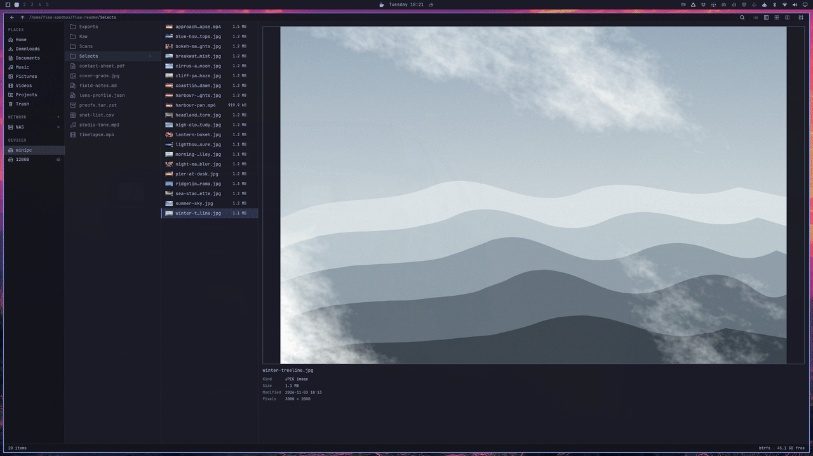
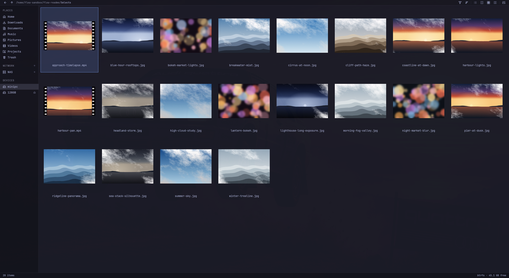
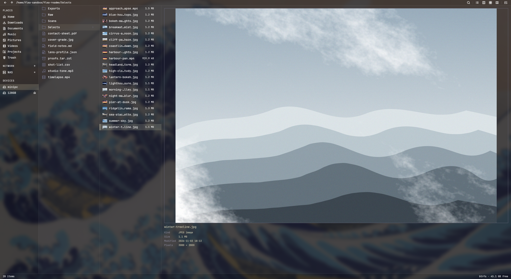
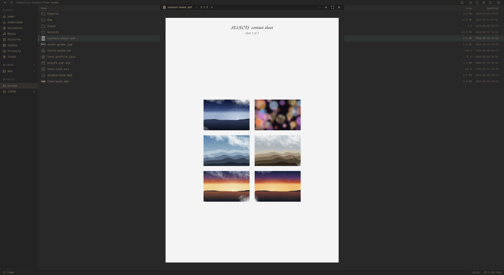
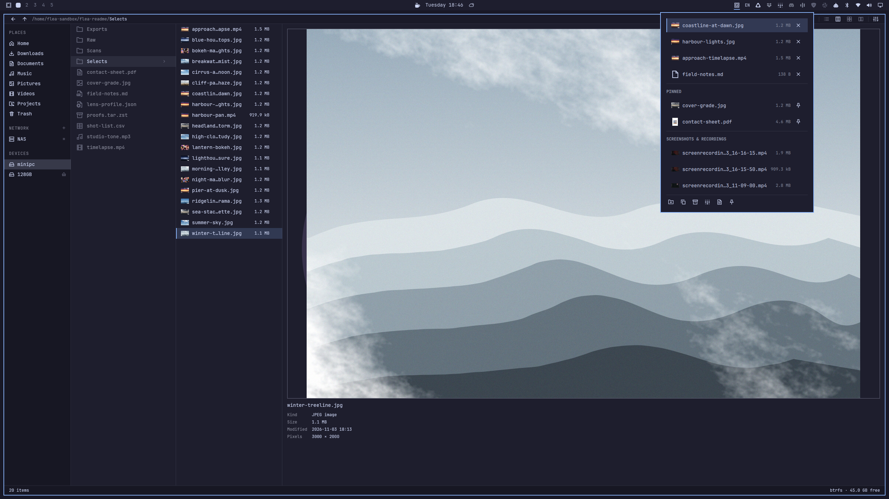

<p align="center">
  
</p>

<h1 align="center">Flea</h1>

<p align="center">
  <strong>The fastest GUI file manager on Omarchy.</strong>
</p>

<p align="center">
  <a href="https://github.com/tcballard/omarchy-badges"></a>
</p>

<p align="center">
  <a href="#install">Install</a> ·
  <a href="#views">Views</a> ·
  <a href="#performance">Performance</a> ·
  <a href="#keyboard">Keyboard</a> ·
  <a href="https://github.com/thisisgm/flea/releases">Releases</a>
</p>

<p align="center">
  
</p>

- **Four views.** List, columns, grid and two panes, with tabs and natural sorting.
- **Quick Look.** Space previews images, PDFs, text, media, archives and 3D model thumbnails.
- **File operations.** Copy, move, rename, trash, compress and extract, with undo. Rename many files at once.
- **Tags.** Seven tags in your theme's colours, set with `T` then `1` to `7`, found with `tag:red`.
- **Search.** Ranked results as you type.
- **Network and sharing.** SMB, SFTP, FTPS, WebDAV, NFS, Dropbox and Taildrop.
- **Devices.** USB and encrypted drives, phones and cameras, mounted from the sidebar.
- **Disk images.** Write an ISO or IMG to a USB drive, even compressed or zipped, and verify every byte.
- **Desktop integration.** Default file manager, “Show in folder” and Open/Save dialogs.
- **Your settings.** Omarchy text sizes, configurable menus, and Default, Vim, Mac or Windows keys.

## Install

Flea is available only from the Omarchy Package Repository. Install it and make it your default
file manager, file chooser and the app opened by **Super+Shift+F**:

```bash
omarchy pkg add flea && flea --default
```

Run `flea --default` from a terminal in your session so file dialogs switch at once. `flea --default off`
undoes it, and Settings > About has the same switch. To try Flea without changing your defaults, run
only `omarchy pkg add flea`. Updates come with `omarchy update`.

On an AUR `flea-bin` or `flea-git` install, run this and answer `y` when pacman asks to remove it:

```bash
sudo pacman -S flea
```

<details>
<summary>File chooser only, development build and removal</summary>

Use Flea for portal Open/Save dialogs without changing your default file manager:

```bash
flea --picker
```

To try unreleased changes from `main`, [build Flea from source](#build).

Before removing Flea, undo its desktop integration, then drop the package:

```bash
flea --default off
omarchy pkg drop flea
```

[Installation details](docs/install.md) cover dependencies, desktop integration and removal.

</details>

## Views

**List** for details, **grid** for photos and clips, **columns** for browsing with a preview, and
**two panes** (`Ctrl+4`) for two folders side by side. Flea can remember the view for each folder.

<p align="center">
  
  
</p>

**Space** opens Quick Look in any view. Page through a PDF, play media, zoom an image with `+` and
`-`, or look inside an archive, ISO image or package.

<p align="center">
  
</p>

**The shelf** in the Omarchy bar holds files you send to it from any menu. Drag them out into any
app, or pin the ones you reuse.

**Dragging** moves files within a device and copies them across devices. Hold Ctrl to copy, Shift to
move, or both to link. Drop files on Trash in the sidebar to trash them, and `z` brings them back.
Drag a file into a terminal to paste its path.

<p align="center">
  
  
</p>

**Transparency** follows Omarchy's Window Transparency (Trigger > Appearance > Window
Transparency). To set Flea's own, give a value from 0 to 1 in a theme's `shell.toml`, or in
`~/.config/omarchy/shell.toml` for every theme:

```toml
[flea]
background-alpha = 0.34
```

## Performance

Measured on 2 November 2026 with the 0.4.0 candidate at `8a7fd82f`, before the final
release cut. Tables show medians; [full observed ranges, versions and methodology](docs/bench/0.4.0-20261102.md)
are recorded with the data.

### 100,000 files

One folder of empty files on btrfs, three runs per app. Flea and Strata use List;
the other apps use their installed icon views.

| File manager | Version | First window | Settled | PSS | CPU |
| --- | --- | ---: | ---: | ---: | ---: |
| **Flea** | 0.4.0 | 319 ms | 0.75 s | 63.0 MiB | 0.53 s |
| Dolphin | 26.08.2 | 791 ms | 5.25 s | 235.1 MiB | 8.18 s |
| Nautilus | 51.1.0 | 931 ms | 20.33 s | 337.2 MiB | 21.67 s |
| Nemo | 6.6.4 | 928 ms | 22.61 s | 479.3 MiB | 26.03 s |
| PCManFM | 1.4.0 | 479 ms | 35.29 s | 124.4 MiB | 24.25 s |
| Strata | 1.1.1 | 835 ms | 1.80 s | 159.1 MiB | 1.83 s |
| Thunar | 4.20.10 | 601 ms | 19.71 s | 394.9 MiB | 19.82 s |

Flea's samples are fresh; unchanged rival measurements were reused after matching the
machine, session, versions and fixture. First window means compositor registration;
settled means 500 ms of process-tree CPU quiet. Neither measures paint or input readiness.

### Search across one million files

Thirty measured runs per engine, plus two five-round noise batches.

| Search engine | Version | First result | Backend PSS after indexing |
| --- | --- | ---: | ---: |
| **Flea** | 0.4.0 | 166 ms | 75.7 MiB |
| nd | 0.2.1 | 1617 ms | 145.6 MiB |
| fff | 0.11.1 | 3172 ms | 221.2 MiB |
| FSearch | 0.3.0 | 4938 ms | 157.0 MiB |

The clock runs from backend `searchopen` to the first nonempty current-generation IPC rows.
Process creation and initial listing are outside it. These are backend measurements, not
GUI-open timings. Flea's mixed typed-first quality still trails nd and fff;
[the results include those losses](docs/bench/0.4.0-20261102.md#method-and-scope).

### Compared with 0.3.12

Three interleaved cold runs per build on the same minipc.

| Metric | 0.4.0 | 0.3.12 |
|---|---:|---:|
| First window | 348 ms | 525 ms |
| GUI + backend PSS | 58.6 MiB | 88.4 MiB |
| Resident GPU memory | 83.4 MiB | 142.7 MiB |

The baseline is a frozen copy of the 0.3.12 package. PSS and GPU memory are sampled
three seconds after mapping.

### Media

The 2,000-entry fixture contains 1,800 thumbnailable media files and 200 text controls.
Flea's first-window, settled and CPU values have three valid samples. Memory has only
two, and its observed use is higher than Thunar's and Nemo's. Incomplete measurements
for the other apps prevent a complete media ranking. [Recorded values and gaps](docs/bench/0.4.0-20261102.md#media).

[Data and provenance](docs/bench/0.4.0-20261102.md) · [Method](docs/benchmarks.md) ·
[Historical results](docs/bench/local-0.3.10-20261012.manifest.md)

## Keyboard

Press **?** for the full keymap, or **,** to change settings.

| Action | Keys |
|---|---|
| Move / parent / enter | `j` `k` / `h` / `l` |
| Open with the default app | `Enter` |
| Quick Look | `Space` |
| Select / extend selection | `v` / `Shift` + arrows |
| Copy / cut / paste | `y` `x` `p`, or `Ctrl+C` `Ctrl+X` `Ctrl+V` |
| Rename / trash / undo / redo | `r` or `F2` / `dd` or `Delete` / `z` / `Ctrl+Shift+Z` |
| Tag the selection | `T`, then `1` to `7` |
| New folder | `Ctrl+Shift+N` |
| Search / filter the list | `f` / `/` |
| Enter a path, or jump to a folder by name | `:` or `Ctrl+L`, then a path or a name |
| List / columns / grid / two panes | `Ctrl+1` / `Ctrl+2` / `Ctrl+3` / `Ctrl+4` |
| Next / previous area | `Tab` / `Shift+Tab` |
| New tab / close tab / switch tab | `t` / `w` / `1` to `9` |
| Open terminal / context menu | `Ctrl+T` / `m` |
| Show hidden files | `.` |
| Zoom an image in Quick Look / fit | `+` `-` / `0` |

The Windows preset uses `Ctrl+Shift+1/2/3/4` for views and `Ctrl+Y` for redo.
See [the full key table](keys.toml) for preset bindings and pointer actions.

## Scripts and agents

Every Flea window is titled Flea. To find which folder each one shows, ask it over IPC by its process id:

```sh
for p in $(hyprctl clients -j | jq -r '.[] | select(.class == "com.thisisgm.flea") | .pid'); do
    echo "$p $(flea ipc --pid "$p" call flea path)"
done
```

To open a folder and know when a window shows it, run `flea /path/to/folder`, then poll
`flea ipc --pid PID call flea path` until it prints that path.

## Build

Requires Omarchy and Rust. See
[installation details](docs/install.md) for runtime and optional dependencies.

```bash
cargo build --locked --release --workspace
./target/release/flea --gui
```

Pass a directory to open it, or `--select <path>` to reveal a file.

`./tests/run-all.sh` runs the headless suites, and [the protocol guide](docs/protocol.md) documents
the backend.

See [PLUGINS.md](PLUGINS.md) to write, validate, install and debug a Flea plugin, with a working example for each kind.

## Support

If this saved you an afternoon, you can
[sponsor me on GitHub](https://github.com/sponsors/thisisgm) or
[buy me a coffee](https://buymeacoffee.com/thisisgm).

<p>
  <a href="https://buymeacoffee.com/thisisgm"></a>
  <a href="https://www.greptile.com/?utm_source=oss_badge&utm_medium=readme&utm_campaign=greptile_for_open_source"></a>
</p>

## Licence

[MIT](LICENSE).

The AirDrop plugin is built on [owly](https://github.com/t4t5/owly) by Tristan
([t4t5](https://github.com/t4t5)), MIT, which Flea runs as a separate program.

The language marks in `ui/js/LangMarkPaths.js` use [simple-icons](https://github.com/simple-icons/simple-icons)
geometry (CC0 1.0) and remain their owners' trademarks.
