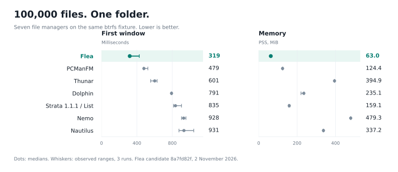
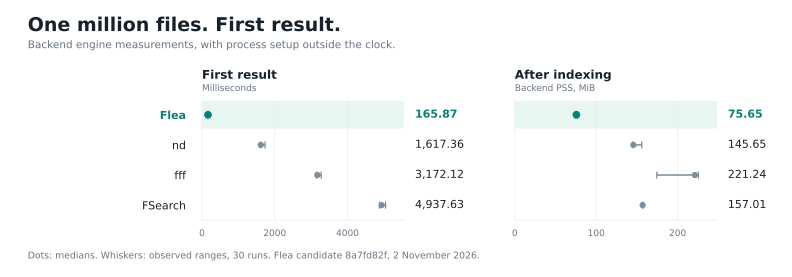

<p align="center">
  
</p>

<h1 align="center">Flea</h1>

<p align="center">
  <strong>The fastest GUI file manager on Omarchy.</strong>
</p>

<p align="center">
  <a href="https://github.com/tcballard/omarchy-badges"></a>
</p>

<p align="center">
  <a href="#install">Install</a> ·
  <a href="#views">Views</a> ·
  <a href="#performance">Performance</a> ·
  <a href="#keyboard">Keyboard</a> ·
  <a href="https://github.com/thisisgm/flea/releases">Releases</a>
</p>

<p align="center">
  
</p>

- **Four views.** List, columns, grid and two panes, with tabs and natural sorting.
- **Quick Look.** Space previews images, PDFs, text, media, archives and 3D model thumbnails.
- **File operations.** Copy, move, rename, trash, compress and extract, with undo. Rename many files at once.
- **Tags.** Seven tags in your theme's colours, set with `T` then `1` to `7`, found with `tag:red`.
- **Search.** Ranked results as you type.
- **Network and sharing.** SMB, SFTP, FTPS, WebDAV, NFS, Dropbox and Taildrop.
- **Devices.** USB and encrypted drives, phones and cameras, mounted from the sidebar.
- **Disk images.** Write an ISO or IMG to a USB drive, even compressed or zipped, and verify every byte.
- **Desktop integration.** Default file manager, “Show in folder” and Open/Save dialogs.
- **Your settings.** Omarchy text sizes, configurable menus, and Default, Vim, Mac or Windows keys.

## Install

Flea is available only from the Omarchy Package Repository. Install it and make it your default
file manager, file chooser and the app opened by **Super+Shift+F**:

```bash
omarchy pkg add flea && flea --default
```

Run `flea --default` from a terminal in your session so file dialogs switch at once. `flea --default off`
undoes it, and Settings > About has the same switch. To try Flea without changing your defaults, run
only `omarchy pkg add flea`. Updates come with `omarchy update`.

On an AUR `flea-bin` or `flea-git` install, run this and answer `y` when pacman asks to remove it:

```bash
sudo pacman -S flea
```

<details>
<summary>File chooser only, development build and removal</summary>

Use Flea for portal Open/Save dialogs without changing your default file manager:

```bash
flea --picker
```

To try unreleased changes from `main`, [build Flea from source](#build).

Before removing Flea, undo its desktop integration, then drop the package:

```bash
flea --default off
omarchy pkg drop flea
```

[Installation details](docs/install.md) cover dependencies, desktop integration and removal.

</details>

## Views

**List** for details, **grid** for photos and clips, **columns** for browsing with a preview, and
**two panes** (`Ctrl+4`) for two folders side by side. Flea can remember the view for each folder.

<p align="center">
  
  
</p>

**Space** opens Quick Look in any view. Page through a PDF, play media, zoom an image with `+` and
`-`, or look inside an archive, ISO image or package.

<p align="center">
  
</p>

**The shelf** in the Omarchy bar holds files you send to it from any menu. Drag them out into any
app, or pin the ones you reuse.

**Dragging** moves files within a device and copies them across devices. Hold Ctrl to copy, Shift to
move, or both to link. Drop files on Trash in the sidebar to trash them, and `z` brings them back.
Drag a file into a terminal to paste its path.

<p align="center">
  
  
</p>

**Transparency** follows Omarchy's Window Transparency (Trigger > Appearance > Window
Transparency). To set Flea's own, give a value from 0 to 1 in a theme's `shell.toml`, or in
`~/.config/omarchy/shell.toml` for every theme:

```toml
[flea]
background-alpha = 0.34
```

## Performance

**November 2026 · 0.4.0 candidate · measured on Omarchy**

These results use candidate `8a7fd82f`, before the final release cut. Charts show medians
and observed ranges. [Full data and methodology](docs/bench/0.4.0-20261102.md).

### A folder with 100,000 files

<picture>
  <source media="(prefers-color-scheme: dark)" srcset="docs/bench/images/scale-0.4.0-dark.svg">
  
</picture>

Three runs per arm. Flea and Strata use List; the other apps use their installed icon views.
Strata is the stable **1.1.1** release. Flea's samples are fresh; unchanged rival results
were reused after the machine, session, versions and fixture were matched.

<details>
<summary>Versions, all four metrics and exact ranges</summary>

Values are **median [minimum, maximum]**. One Strata version and view is shown here.

| File manager / version / view | First window (ms) | Settled (ms) | PSS (MiB) | CPU (s) |
|---|---:|---:|---:|---:|
| **Flea 0.4.0 candidate / list** | 319 [318, 427] | 753 [751, 860] | 63.01 [62.87, 63.84] | 0.531 [0.512, 0.538] |
| Dolphin 26.08.2-1 / icons | 791 [788, 795] | 5245 [5074, 5457] | 235.06 [220.27, 236.19] | 8.178 [8.066, 8.439] |
| Nautilus 51.1-1 / icons | 931 [875, 1042] | 20328 [19782, 21076] | 337.22 [335.91, 338.76] | 21.672 [20.912, 21.908] |
| Nemo 6.6.4-1 / icons | 928 [904, 954] | 22609 [22170, 22731] | 479.31 [479.00, 480.59] | 26.029 [25.380, 26.213] |
| PCManFM 1.4.0-2 / icons | 479 [477, 524] | 35293 [33553, 35996] | 124.37 [123.85, 125.72] | 24.250 [23.402, 24.282] |
| Strata 1.1.1 / list | 835 [814, 904] | 1802 [1785, 1832] | 159.12 [155.70, 161.72] | 1.826 [1.820, 1.894] |
| Thunar 4.20.10-1 / icons | 601 [555, 628] | 19707 [19642, 19769] | 394.88 [394.80, 395.12] | 19.820 [19.757, 20.043] |

Flea ranks first among the seven tested families for these four metrics on this fixture.
First window records compositor registration. Settled means 500 ms of process-tree CPU
quiet; neither establishes that every row was painted or input was ready. CPU includes
helpers. PSS depends on shared libraries and the session's other applications.

</details>

### Search across one million files

<picture>
  <source media="(prefers-color-scheme: dark)" srcset="docs/bench/images/search-0.4.0-dark.svg">
  
</picture>

Thirty measured runs per engine, plus two five-round noise batches. Timing starts at
`searchopen` and ends at the first nonempty current-generation IPC rows; process creation
and initial listing are outside the clock. Memory is backend PSS after indexing.
Mixed typed-first quality still trails nd and fff.

<details>
<summary>Engine versions, exact ranges and search quality</summary>

Values are **median [minimum, maximum]**.

| Engine / version | First result (ms) | Indexed backend PSS (MiB) |
|---|---:|---:|
| **Flea 0.4.0 candidate** | 165.87 [161.46, 169.59] | 75.65 [74.11, 76.92] |
| nd v0.2.1 | 1617.36 [1602.04, 1733.15] | 145.65 [145.06, 155.93] |
| fff 0.11.1-nightly, g7353971 | 3172.12 [3142.71, 3276.40] | 221.24 [174.49, 225.54] |
| FSearch c20e6b1 | 4937.63 [4879.67, 5045.53] | 157.01 [156.96, 157.11] |

These are backend engine measurements, not GUI-open or paint timings. Search quality is
separate: Flea and nd placed all five final targets first, while Flea's mixed typed-first
score of 39.39% trails nd's 48.48% and fff's 56.57%. Full-trace failures for fff and FSearch
remain in the quality record; the table ranks only the two eligible engine metrics.

</details>

### Compared with 0.3.12

Three interleaved cold runs per build on the same minipc, opening 100,000 empty files.
The baseline is a frozen copy of the installed 0.3.12 package.
Values are **median [minimum, maximum]**.

| Metric | Flea 0.4.0 candidate | Flea 0.3.12 |
|---|---:|---:|
| First window | 348 [343, 434] ms | 525 [522, 538] ms |
| GUI + backend PSS | 58.63 [57.70, 58.69] MiB | 88.40 [88.27, 88.63] MiB |
| Resident GPU memory | 83.45 [83.45, 83.45] MiB | 142.68 [142.68, 142.68] MiB |

First window is Hyprland's window-open event. GUI + backend PSS and resident GPU memory
are sampled three seconds after mapping. This clock does not measure paint or input readiness.

### Media results

Four media comparisons remain **partial or refused**. Flea's observed memory use is higher
than Thunar's and Nemo's; no complete media ranking is claimed.

<details>
<summary>Measured values and remaining gaps</summary>

The 2,000-entry btrfs fixture contains 1,800 thumbnailable media files and 200 text controls.
Flea's completed values below have three valid samples each.

| Flea 0.4.0 candidate | Median [minimum, maximum] |
|---|---:|
| First window | 326 [320, 419] ms |
| Settled | 1544 [1517, 1679] ms |
| CPU | 4.475 [4.437, 4.693] s |

Flea's memory result is partial: two of three samples qualified, spanning
160.30 to 168.51 MiB.
Those observed values are higher than Thunar's 125.41 to 126.29 MiB and Nemo's
100.14 to 106.53 MiB. PCManFM did not reach an eligible endpoint within 120 seconds;
Strata's render observer could not establish valid work counts; Nautilus and Dolphin
lacked helper PSS. These gaps prevent a complete media ranking.

</details>

[Data and provenance](docs/bench/0.4.0-20261102.md) · [Method](docs/benchmarks.md) ·
[Historical results](docs/bench/local-0.3.10-20261012.manifest.md)

## Keyboard

Press **?** for the full keymap, or **,** to change settings.

| Action | Keys |
|---|---|
| Move / parent / enter | `j` `k` / `h` / `l` |
| Open with the default app | `Enter` |
| Quick Look | `Space` |
| Select / extend selection | `v` / `Shift` + arrows |
| Copy / cut / paste | `y` `x` `p`, or `Ctrl+C` `Ctrl+X` `Ctrl+V` |
| Rename / trash / undo / redo | `r` or `F2` / `dd` or `Delete` / `z` / `Ctrl+Shift+Z` |
| Tag the selection | `T`, then `1` to `7` |
| New folder | `Ctrl+Shift+N` |
| Search / filter the list | `f` / `/` |
| Enter a path, or jump to a folder by name | `:` or `Ctrl+L`, then a path or a name |
| List / columns / grid / two panes | `Ctrl+1` / `Ctrl+2` / `Ctrl+3` / `Ctrl+4` |
| Next / previous area | `Tab` / `Shift+Tab` |
| New tab / close tab / switch tab | `t` / `w` / `1` to `9` |
| Open terminal / context menu | `Ctrl+T` / `m` |
| Show hidden files | `.` |
| Zoom an image in Quick Look / fit | `+` `-` / `0` |

The Windows preset uses `Ctrl+Shift+1/2/3/4` for views and `Ctrl+Y` for redo.
See [the full key table](keys.toml) for preset bindings and pointer actions.

## Build

Requires Omarchy, Quickshell 0.3.1 or newer, and Rust. See
[installation details](docs/install.md) for runtime and optional dependencies.

```bash
cargo build --release
FLEA_UI="$PWD/ui" ./target/release/flea --gui
```

Pass a directory to open it, or `--select <path>` to reveal a file.

`./tests/run-all.sh` runs the headless suites, and [the protocol guide](docs/protocol.md) documents
the backend.

## Support

If this saved you an afternoon, you can
[sponsor me on GitHub](https://github.com/sponsors/thisisgm) or
[buy me a coffee](https://buymeacoffee.com/thisisgm).

## Licence

[MIT](LICENSE).

The language marks in `ui/js/LangMarkPaths.js` use [simple-icons](https://github.com/simple-icons/simple-icons)
geometry (CC0 1.0) and remain their owners' trademarks.
